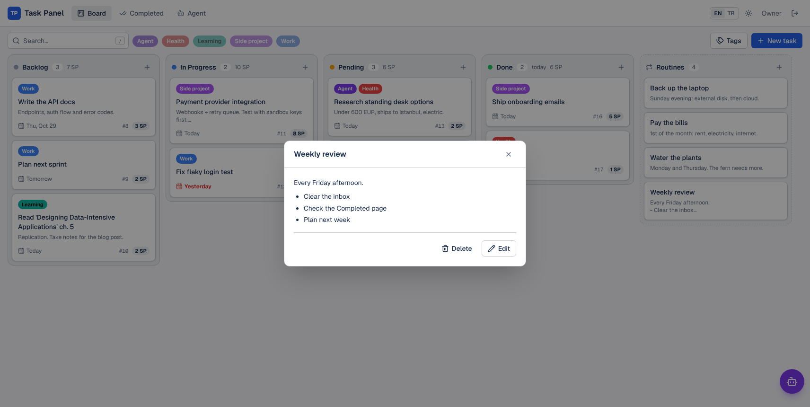
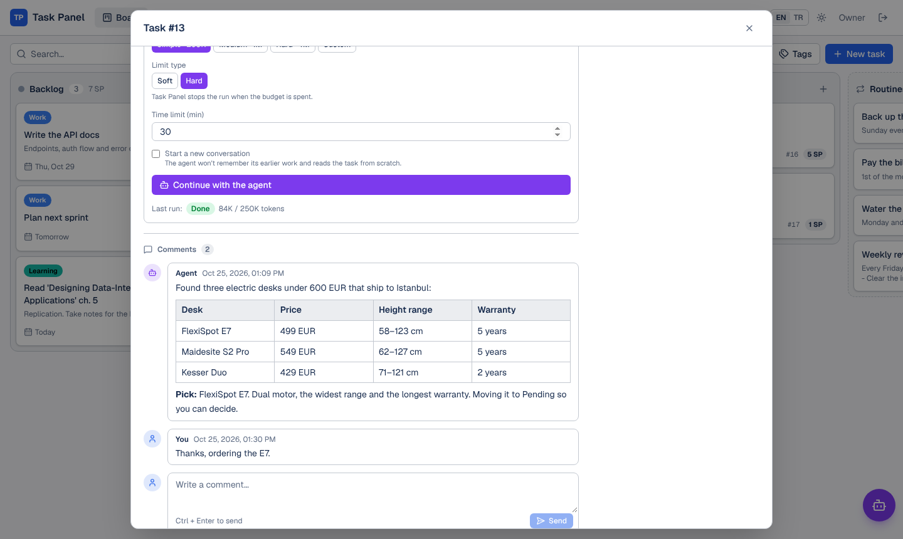
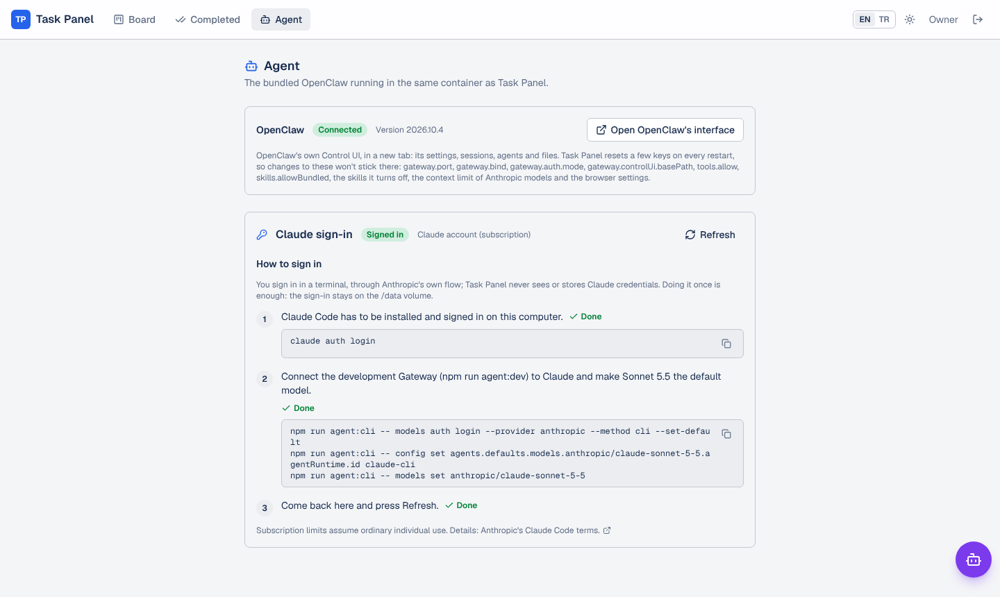
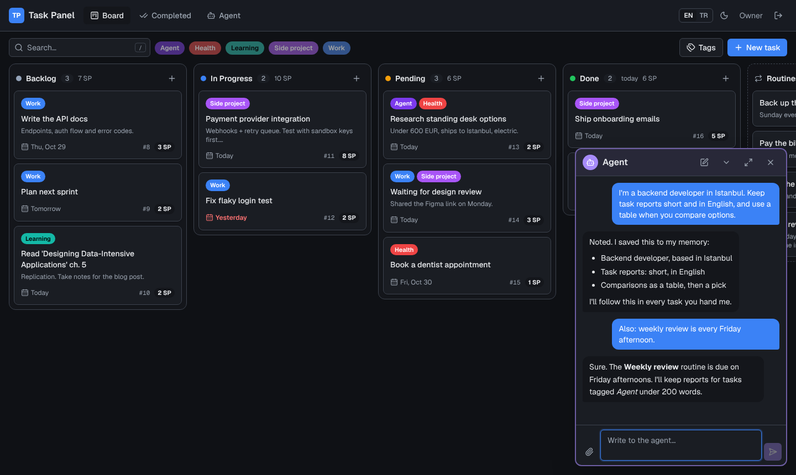
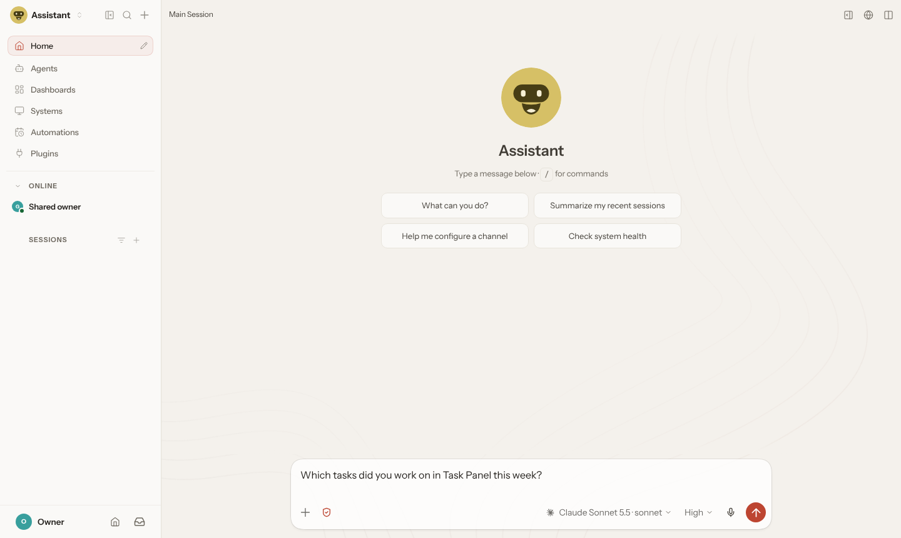
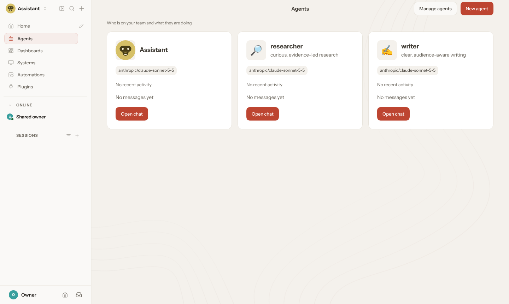
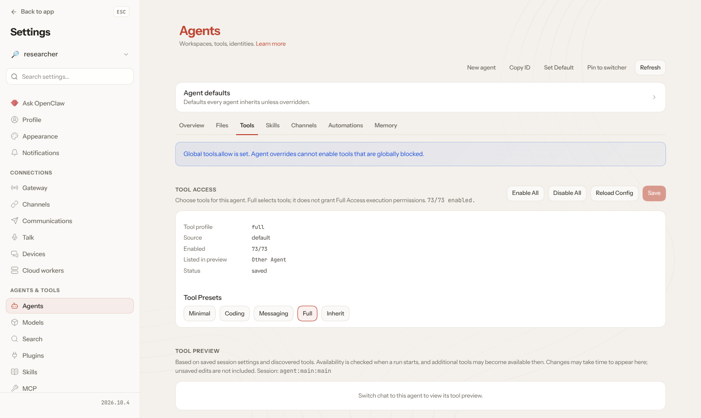
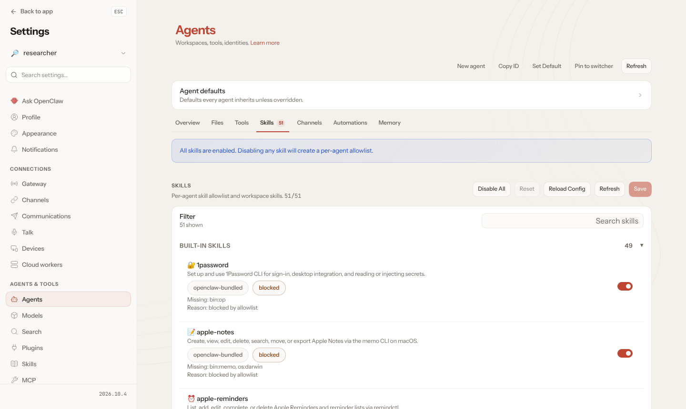

# Task Panel

[](https://github.com/m-aziz-algullu/task-panel/actions/workflows/ci.yml)
[](LICENSE)

**English** · [Türkçe](README.tr.md)

A self-hosted, single-user kanban board for your own tasks. Tags with your own colors, story points, a day on every task, and finished tasks that leave the board at midnight and land in a day-by-day archive. Optionally, a bundled AI agent works on the tasks you hand it.


| Dark mode | Task details | Completed, grouped by day | A routine |
| --- | --- | --- | --- |
|  |  |  |  |

## Features

- **Board** with four fixed columns: Backlog, In Progress, Pending, Done. Drag and drop between and within columns (mouse, touch and keyboard).
- **Tasks** have a title, description, day, story points (1, 2, 3, 5, 8, 13, 21) and tags. Cards show tags, the day, `#id` and points; open tasks past their day are highlighted.
- **Rich text descriptions** (Jira-style): headings, bold/italic/underline/strike, text colors and highlights, bullet/numbered lists, checklists, quotes, code, links, tables and dividers. Markdown shortcuts (`# `, `- `, `[ ] `, `**bold**`…), a `/` quick-insert menu, `Ctrl+K` for links and `Ctrl`+click to open them.
- **Comments** on every task, from you, the agent and the system (e.g. why an agent run stopped).
- **Tags** with a name and any color; filter the board by tag or search text.
- **End of day:** tasks moved to Done stay on the board until midnight (in `APP_TIMEZONE`), then move to the **Completed** page, which lists them by day at full card size, for the last 7 or 30 days or a whole month. An open tab refreshes itself at midnight. Moving a task planned for another day to Done asks whether to record it on that day or move it to today.
- **Routines:** a last column on the board for recurring chores, each a title and Markdown notes you open when it's due. They aren't tasks, so they have no status, day or points.
- **AI agent (optional):** the default Docker image bundles an [OpenClaw](https://openclaw.ai) agent that works on your tasks, running on your Claude subscription or a model provider's API key (see [Self-hosting](#self-hosting)).
  - **Hand to agent** in a task queues a run: the task moves to In Progress, the agent posts its report as a comment and moves the task on (to Pending by default). Each run has its own model, thinking level, time limit and token budget (Simple, Medium or Hard; a soft budget the agent keeps to, or a hard one Task Panel enforces).
  - Adding a tag you choose hands a task to the agent automatically. A comment on a task the agent has worked on continues the same conversation.
  - **Talk to the agent** opens a chat window: tell it about yourself and your preferences or send files (up to 5, 10 MB each); it keeps what lasts in its memory.
  - The **Agent** page shows the connection and Claude sign-in, holds the defaults (model, budgets, how many runs at once, where finished or stuck tasks go, standing instructions) and opens OpenClaw's own interface.
- **English and Turkish** UI, picked from the browser language and switchable in the header.
- Light and dark mode.
- Keyboard shortcuts: `N` new task, `/` search, `Ctrl+Enter` save, `Esc` close.
- **Single admin account, protected setup** (see below).

## The agent at work

A task handed to the agent (here through the *Agent* tag) gets a run; the agent posts its report as a comment and moves the task on. You can reply in the comments to continue the same conversation.



| Agent page | Chat window |
| --- | --- |
|  |  |

**OpenClaw's own interface** (Agent page → *Open OpenClaw's interface*) lets you talk to the agent directly, create more agents, and choose each agent's tools and skills.

| Chat in OpenClaw | Your agents |
| --- | --- |
|  |  |
| **An agent's tools** | **An agent's skills** |
|  |  |

## How sign-up works

There's exactly one account. On a fresh install the app has no users and:

1. On startup, the server prints a one-time **setup code** to its logs:
   ```
   ============================================================
    Task Panel setup: no admin account yet.
    Open /register and enter this setup code:

        K7PQ-3XMA-9WRT-H2CD
   ============================================================
   ```
2. Opening the app takes you to the **Setup** page, which asks for that code plus your name, email and password.
3. Once the admin account exists, the setup page and the sign-up action are closed for good. Only sign-in remains.

Only someone who can read the server logs can create the account, so a stranger who finds your URL before you do can't take it over. To pick the code yourself, set `SETUP_TOKEN`.

**Brute-force protection:** sign-in allows 10 failed attempts per IP and 50 per account within 15 minutes, then refuses further attempts (without checking the password) until the window passes. Setup codes are limited per IP the same way. Responses also send `Strict-Transport-Security`, so browsers stick to HTTPS once they've seen your domain over it.


## Quick start (local development)

Requires Node.js 24+.

```bash
npm install
npm run dev
```

Open http://localhost:3000 and use the setup code printed in the terminal. Without `DATABASE_URL`, development uses an embedded PostgreSQL ([PGlite](https://pglite.dev)) stored in `./.data/pglite`, so there's nothing else to install. To use a real Postgres, copy `.env.example` to `.env.local` and set `DATABASE_URL`.

```bash
npm run lint
npm run typecheck
npm test
```

**Bundled OpenClaw agent (optional):** run `npm run agent:dev` in a second terminal. It installs the OpenClaw Gateway into `./.data/openclaw-runtime` once and starts it on `127.0.0.1:18799` with `./.data/openclaw` as its home, so your own `~/.openclaw` is never touched. To let it use your Claude subscription, sign in to Claude Code on your computer (`claude auth login`) and run `npm run agent:cli -- models auth login --provider anthropic --method cli --set-default`, then select Sonnet 5.5 with `npm run agent:cli -- config set agents.defaults.models.anthropic/claude-sonnet-5-5.agentRuntime.id claude-cli` and `npm run agent:cli -- models set anthropic/claude-sonnet-5-5`; the **Agent** page shows whether it worked.

To move to another OpenClaw release, run `npm run openclaw:upgrade -- <version>`: it updates the client packages and the Docker image's `OPENCLAW_VERSION` together, once that image is published. Dependabot leaves OpenClaw alone, since the two must match.

## Self-hosting

Production runs on **PostgreSQL only**: the server refuses to start without `DATABASE_URL`. Tables are created and migrated automatically on startup.

The default Docker image also runs a bundled [OpenClaw](https://openclaw.ai) Gateway in the same container as Task Panel:
- The Gateway is reachable only from inside the container (loopback) and generates its own token on first start. Only model provider keys and OpenClaw's own settings are passed on to it; `DATABASE_URL` and the app's other variables stay with Task Panel.
- OpenClaw's own web interface (Control UI: settings, sessions, agents, files) opens from the **Agent** page with **Open OpenClaw's interface**. It's served at `/openclaw/` on Task Panel's own address, only to a signed-in user; no SSH tunnel or extra port is needed. Settings Task Panel writes on every start (listed on that page) don't stick when changed there.
- The agent's memory, sessions, provider keys and skills live under `/data`. **Mount a volume at `/data`**, or they are reset on every deploy.
- Plan for at least 2 GB of RAM for this image.
- The agent's browser (Chromium) runs with `browser.noSandbox` and `--disable-dev-shm-usage`: Chromium's own sandbox needs privileges Docker doesn't grant, and Docker's `/dev/shm` is only 64 MB. The container and its unprivileged user still isolate it. To keep Chromium's sandbox instead, give the container `--cap-add=SYS_ADMIN` (or a seccomp profile that allows it) and set `TASKPANEL_BROWSER_SANDBOX=on`.
- To keep every model call small, the agent gets only the tools Task Panel's work needs (`tools.allow`: files, the shell, `web_search`, `web_fetch`, memory, goals, PDFs, images and skills; no browser, sessions, canvas or media generation), a few bundled skills (`skills.allowBundled`; skills you install are not affected), and a 150k-token context for Sonnet 5.5 and Opus 5.5 (`models.providers.anthropic.models[].contextTokens`), at which Claude Code compacts the conversation. These are written on every start; to give the agent more, change `managedConfig` in `docker/openclaw-bootstrap.mjs`.
- The agent searches the web with OpenClaw's `web_search` and reads pages with `web_fetch`. Each start installs the Parallel plugin (`@openclaw/parallel-plugin`, same version as OpenClaw) if it's missing, and picks its key-free `parallel-free` search provider when no provider is set. A provider you choose yourself (`tools.web.search.provider`) is kept.
- If you don't want the agent, build the smaller image with `docker build --target plain .`, or set `TASKPANEL_AGENT=off`.

### Docker Compose

```bash
POSTGRES_PASSWORD=choose-a-password docker compose up -d
docker compose logs app   # the setup code is here
```

Then open http://localhost:3000. The `app-data` volume is mounted at `/data`.

### Dokploy

1. **Database:** *Create Service → Database → PostgreSQL*, deploy it, and copy its **Internal Connection URL**.
2. **App:** *Create Service → Application*, connect this repository, **Build Type: Dockerfile**.
3. **Environment:**
   ```
   DATABASE_URL=<internal connection URL from step 1>
   APP_TIMEZONE=Europe/Istanbul
   ```
4. **Volume:** under *Advanced → Volumes → Volume Mount*, add a volume named `task-panel-data` mounted at `/data`.
5. **Domain:** add one with **container port 3000** and HTTPS.
6. **Deploy**, open **Logs**, copy the setup code, and open your domain to create the admin account.

**Backups:** your tasks live in the Postgres volume on the server, the agent's data in the `task-panel-data` volume. In Dokploy, add an S3 destination (AWS S3, Cloudflare R2, Backblaze B2, …) under *Settings → S3 Destinations*, then schedule backups in the database's **Backups** tab, e.g. daily at `0 3 * * *`.

### Agent: sign in with your Claude account

The agent can run on your own Claude subscription through the official Claude Code CLI, without an API key. Do this once per server; the CLI and its login stay on the `/data` volume:

```bash
docker exec -it -u node <container> /srv/docker/agent-shell.sh
curl -fsSL https://claude.ai/install.sh | bash     # installs Claude Code under /data
claude auth login                                   # opens Anthropic's own sign-in
openclaw models auth login --provider anthropic --method cli --set-default
openclaw config set agents.defaults.models.anthropic/claude-sonnet-5-5.agentRuntime.id claude-cli
openclaw models set anthropic/claude-sonnet-5-5    # the agent runs on Sonnet 5.5
```

Each person signs in with their own account, and the sign-in always completes in Anthropic's flow; Task Panel never sees or stores Claude credentials. Subscription limits assume ordinary individual use; see Anthropic's [Claude Code legal and compliance](https://code.claude.com/docs/en/legal-and-compliance) page. For heavy, always-on use, set `ANTHROPIC_API_KEY` instead.

### Environment variables

| Variable | Required | Description |
| --- | --- | --- |
| `DATABASE_URL` | In production | PostgreSQL connection string. |
| `APP_TIMEZONE` | No | IANA time zone that decides when a day ends. Default `Europe/Istanbul`. |
| `SETUP_TOKEN` | No | Your own setup code. If unset, one is generated and printed in the logs. |
| `DATABASE_POOL_SIZE` | No | Max Postgres connections. Default `5`. |
| `PGLITE_DIR` | No | Development only: where the embedded database is stored. |
| `TASKPANEL_AGENT` | No | `off` keeps the agent image from starting OpenClaw. |
| `TASKPANEL_BROWSER_SANDBOX` | No | `on` keeps Chromium's own sandbox for the agent's browser; the container then needs `SYS_ADMIN` or a matching seccomp profile. |
| `OPENCLAW_GATEWAY_TOKEN` | No | Pin the Gateway token yourself. If unset it is generated and kept in `/data/secrets`. |
| `ANTHROPIC_API_KEY`, `OPENAI_API_KEY`, … | No | Model provider keys, passed on to OpenClaw. |

Health check: `GET /api/health`.

## Tech stack

Next.js 16 (App Router, Cache Components, Server Actions), React 19, Tailwind CSS 4, Drizzle ORM, PostgreSQL, dnd-kit, TipTap, and [OpenClaw](https://openclaw.ai) for the agent. Passwords are hashed with scrypt; sessions are random tokens stored as SHA-256 hashes.

## Project structure

```
src/app/[lang]/(panel)/        Board, Completed and Agent pages
src/app/[lang]/(auth)/         Setup (first admin), sign-in, sign-out
src/app/actions.ts             Server Actions for tasks, comments, tags, routines and agent runs
src/app/api/health/            Health check
src/app/api/agent/             Agent chat, Claude sign-in status, run options, Control UI session
docker/                        Container supervisor, bundled OpenClaw setup, Control UI proxy
scripts/agent-dev.mjs          OpenClaw Gateway for development
src/proxy.ts                   Locale redirects and session-cookie gate
src/i18n/                      Dictionaries (en, tr) and helpers
src/lib/db/                    Connection, schema, migrations
src/lib/session.ts             Session checks against the database
src/lib/auth.ts                Password hashing, session tokens
src/lib/setup*.ts              One-time setup code
src/lib/rate-limit*.ts         Sign-in attempt limits
src/lib/dates.ts               Time-zone-aware day math
src/lib/rich-text/             Description schema, checked on every save
src/lib/agent/                 Agent run queue and worker, prompts, chat, settings
src/lib/openclaw/              Connection to the OpenClaw Gateway
src/components/                UI
```

Schema changes go in `src/lib/db/migrations.ts` as a new version; shipped versions are never edited.

## License

[MIT](LICENSE)
