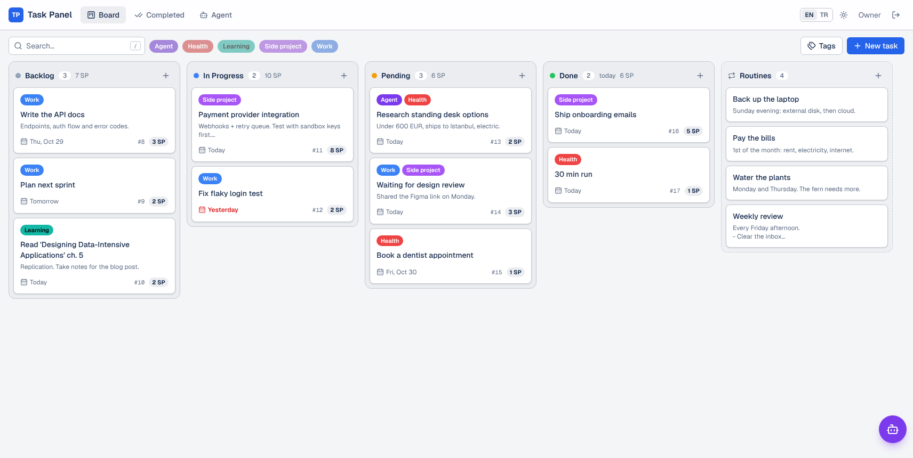
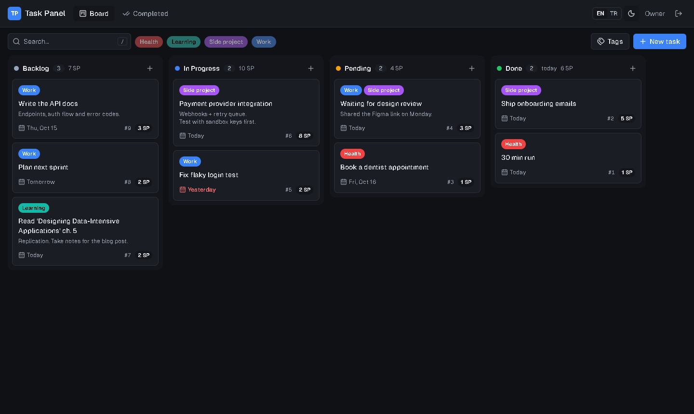
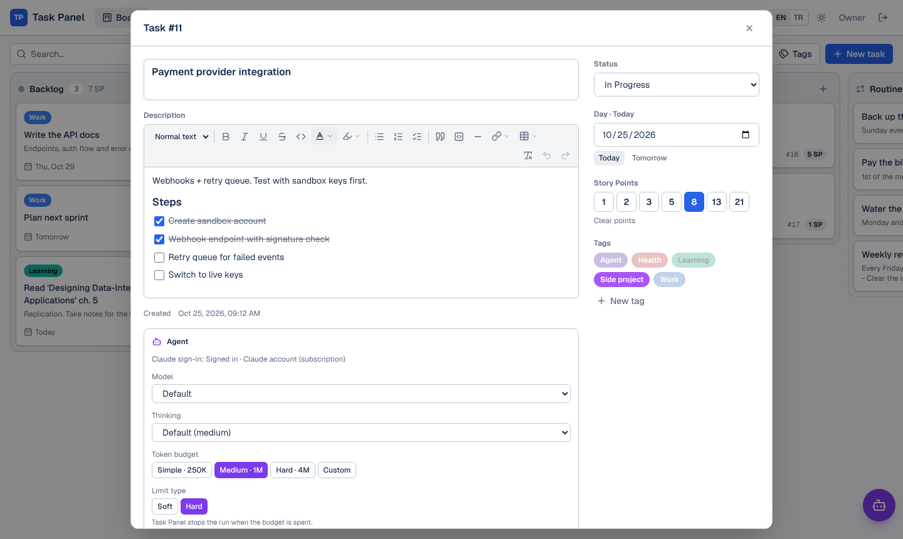
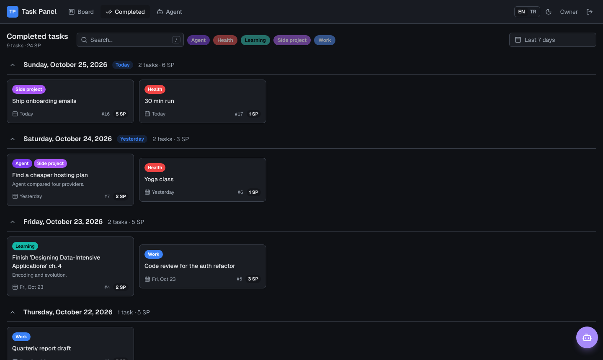
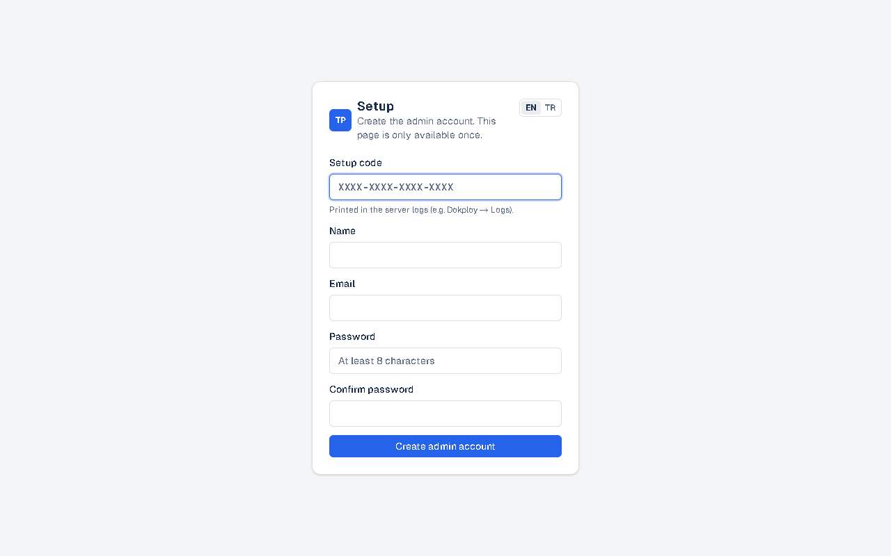

# Task Panel

[](https://github.com/m-aziz-algullu/task-panel/actions/workflows/ci.yml)
[](LICENSE)

[English](README.md) · **Türkçe**

Kendi sunucuna kurduğun, tek kullanıcılı bir kanban panosu. Kendi renklerinle etiketler, story point'ler, her taskın bir günü var. Biten tasklar gece yarısı panodan kalkıp gün gün listelenen bir arşive geçer.



| Koyu tema | Task detayı | Tamamlananlar (gün gün) |
| --- | --- | --- |
|  |  |  |

## Özellikler

- **Pano:** dört sabit kolon (Backlog, In Progress, Pending, Done). Kolonlar arasında ve kolon içinde sürükle-bırak; fare, dokunmatik ve klavyeyle çalışır.
- **Task:** başlık, açıklama, gün, story point (1, 2, 3, 5, 8, 13, 21) ve etiketler. Kartta etiketler, gün, `#id` ve puan görünür. Günü geçmiş açık taskların günü kırmızı yazılır.
- **Etiketler:** isim ve istediğin renk. Panoyu etikete göre filtreleyebilir ya da metinle arayabilirsin.
- **Gün sonu:** Done'a taşınan tasklar gece yarısına kadar (`APP_TIMEZONE`'a göre) panoda kalır, sonra **Tamamlananlar** sayfasına geçer. Orada gün gün ve panodakiyle aynı kart boyutunda listelenir. Açık sekme gece yarısı kendini yeniler.
- **Türkçe ve İngilizce** arayüz. Tarayıcı diline göre seçilir, header'dan değiştirilebilir.
- Açık ve koyu tema.
- Kısayollar: `N` yeni task, `/` arama, `Ctrl+Enter` kaydet, `Esc` kapat.
- **Tek yönetici hesabı, korumalı kurulum** (aşağıda).

## Kayıt nasıl çalışır

Sadece bir hesap var. Yeni kurulumda hiç kullanıcı yokken:

1. Sunucu açılışta loglarına tek seferlik bir **kurulum kodu** basar:
   ```
   ============================================================
    Task Panel setup: no admin account yet.
    Open /register and enter this setup code:

        K7PQ-3XMA-9WRT-H2CD
   ============================================================
   ```
2. Uygulamayı açınca **Kurulum** sayfası gelir. Bu kodu, adını, e-postanı ve şifreni ister.
3. Yönetici hesabı oluştuktan sonra kurulum sayfası ve kayıt işlemi kalıcı olarak kapanır, sadece giriş kalır.

Hesabı sadece sunucu loglarını okuyabilen kişi oluşturabilir. Yani adresini senden önce bulan biri hesabı ele geçiremez. Kodu kendin belirlemek istersen `SETUP_TOKEN` ortam değişkenini ver.

**Kaba kuvvet koruması:** girişte 15 dakika içinde IP başına 10, hesap başına 50 başarısız denemeye izin verilir. Sonrasında süre dolana kadar yeni denemeler şifre kontrol edilmeden reddedilir. Kurulum kodu denemeleri de IP başına aynı şekilde sınırlıdır. Yanıtlar `Strict-Transport-Security` başlığı da gönderir; tarayıcı domain'ini bir kez HTTPS ile gördükten sonra hep HTTPS kullanır.



## Hızlı başlangıç (lokal geliştirme)

Node.js 22+ gerekir.

```bash
npm install
npm run dev
```

http://localhost:3000 adresini aç ve terminalde yazan kurulum kodunu kullan. `DATABASE_URL` yoksa geliştirme ortamı `./.data/pglite` altında gömülü bir PostgreSQL ([PGlite](https://pglite.dev)) kullanır, başka bir şey kurman gerekmez. Gerçek bir Postgres kullanmak istersen `.env.example` dosyasını `.env.local` olarak kopyalayıp `DATABASE_URL` gir.

```bash
npm run lint
npm run typecheck
npm test
```

## Kendi sunucuna kurulum

Production **sadece PostgreSQL** ile çalışır: `DATABASE_URL` yoksa sunucu açılmaz. Tablolar açılışta otomatik oluşturulur ve güncellenir.

### Docker Compose

```bash
POSTGRES_PASSWORD=bir-sifre-sec docker compose up -d
docker compose logs app   # kurulum kodu burada
```

Sonra http://localhost:3000 adresini aç.

### Dokploy

1. **Veritabanı:** *Create Service → Database → PostgreSQL* oluştur, deploy et ve **Internal Connection URL**'i kopyala.
2. **Uygulama:** *Create Service → Application*, bu repoyu bağla, **Build Type: Dockerfile** seç.
3. **Environment:**
   ```
   DATABASE_URL=<1. adımdaki internal URL>
   APP_TIMEZONE=Europe/Istanbul
   ```
4. **Domain:** **Container Port 3000** ile domain ekle, HTTPS'i aç.
5. **Deploy** et, **Logs** sekmesinden kurulum kodunu kopyala ve domain'ini açıp yönetici hesabını oluştur.

**Yedekleme:** veriler sunucudaki Postgres volume'ünde durur. Dokploy'da *Settings → S3 Destinations* altında bir S3 hedefi ekle (AWS S3, Cloudflare R2, Backblaze B2 vb.), sonra veritabanının **Backups** sekmesinden zamanlanmış yedek kur (ör. her gün `0 3 * * *`).

### Ortam değişkenleri

| Değişken | Zorunlu | Açıklama |
| --- | --- | --- |
| `DATABASE_URL` | Production'da | PostgreSQL bağlantı adresi. |
| `APP_TIMEZONE` | Hayır | Günün ne zaman bittiğini belirleyen IANA saat dilimi. Varsayılan `Europe/Istanbul`. |
| `SETUP_TOKEN` | Hayır | Kendi kurulum kodun. Verilmezse kod üretilip loglara yazılır. |
| `DATABASE_POOL_SIZE` | Hayır | En fazla Postgres bağlantısı. Varsayılan `5`. |
| `PGLITE_DIR` | Hayır | Sadece geliştirme: gömülü veritabanının klasörü. |

Sağlık kontrolü: `GET /api/health`.

## Teknolojiler

Next.js 16 (App Router, Cache Components, Server Actions), React 19, Tailwind CSS 4, Drizzle ORM, PostgreSQL, dnd-kit. Şifreler scrypt ile hash'lenir; oturumlar rastgele token'lardır ve veritabanında SHA-256 hash'i olarak tutulur.

## Proje yapısı

```
src/app/[lang]/(panel)/        Pano ve Tamamlananlar sayfaları
src/app/[lang]/(auth)/         Kurulum (ilk yönetici), giriş, çıkış
src/app/actions.ts             Task, etiket ve taşıma Server Action'ları
src/app/api/health/            Sağlık kontrolü
src/proxy.ts                   Dil yönlendirmesi ve oturum çerezi kontrolü
src/i18n/                      Sözlükler (en, tr) ve yardımcılar
src/lib/db/                    Bağlantı, şema, migration'lar
src/lib/session.ts             Oturum doğrulama (veritabanından)
src/lib/auth.ts                Şifre hash'leme, oturum token'ları
src/lib/setup*.ts              Tek seferlik kurulum kodu
src/lib/rate-limit*.ts         Giriş denemesi sınırları
src/lib/dates.ts               Saat dilimine göre gün hesapları
src/components/                Arayüz
```

Şema değişiklikleri `src/lib/db/migrations.ts` dosyasına yeni bir sürüm olarak eklenir; yayınlanmış sürümler düzenlenmez.

## Lisans

[MIT](LICENSE)
